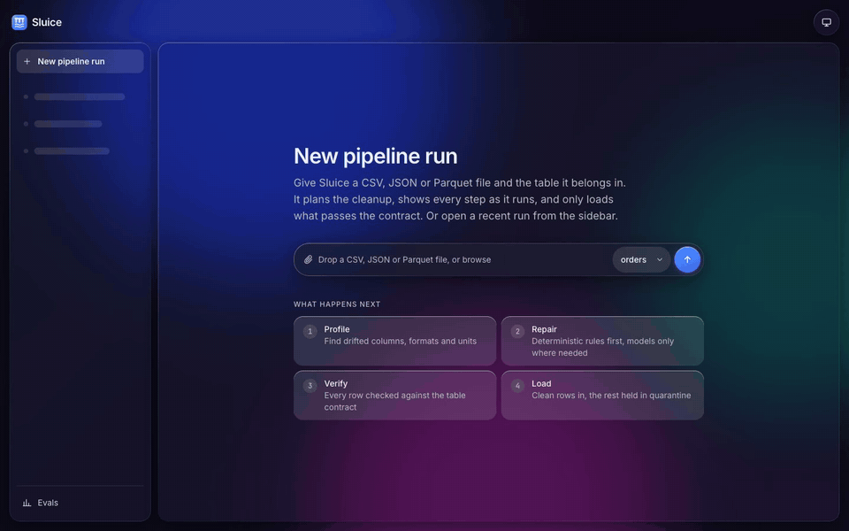

# Sluice

**A self-planning agentic data pipeline for drifting data, measured like production.**



*A real file through the live API: renamed columns, paise and Indian-format numbers, planned, repaired after one failed attempt, verified and loaded (the wait for the models is sped up).*

A file lands with renamed columns, prices in paise instead of rupees, timestamps in IST instead of UTC, three date formats in one column and a few rows pointing at customers that don't exist. Sluice profiles it, **plans its own repair pipeline**, has worker agents write transforms that run in a locked-down sandbox, checks the result against a data contract, repairs what failed, and loads clean data. It records what that cost, how long it took, and exactly which code produced which row.

Every accuracy claim is graded **by code against exact ground truth**, with a baseline, a sample size and a 95% confidence interval.

> **Status:** v1 in progress. The measurement foundations (benchmark, graders, rules-only baseline), the web UI and the LLM agent pipeline (plan 2: LiteLLM routing, sandboxed transforms, verifier, Iceberg load with lineage) are on `main`. The first agent results, on a 30-case dev subset, are below next to the rules-only baseline. The FastAPI + SSE API (plan 4) serves the web UI live: drop a real file and watch it run, with traces in Phoenix.

---

## Why

Production data drifts. Upstream teams rename columns, change types, switch units and formats, and pipelines break or, worse, silently load wrong values. LLM agents can write the fixes, but they can also invent values, run unsafe code and burn money. Most "AI data pipeline" demos never show how often they're right.

Sluice is built to answer the questions a production team would ask:

- **How accurate is it?** Cell-level accuracy against exact ground truth, not an LLM's opinion.
- **Does it make things up?** Fabrication rate: values it filled in where the truth was "unrecoverable, flag it".
- **Is it consistent?** pass^k: does it get the same file right on every one of k runs?
- **What does it cost?** Cost per 1,000 rows, against a rules-only baseline and an always-use-the-strongest-model baseline.
- **Is it safe?** Escapes out of N hostile files designed to break out of the sandbox.
- **What happens when it breaks?** Provider outages, killed workers and bad loads, and how it recovers.

## How it works

```
 drop file (UI) / put object (S3 API)
            │
            ▼
   RustFS bucket ──event──▶ worker pool
                                │
   1  Profile              DuckDB / Polars, no LLM
   2  Rule fixes           deterministic, no LLM
   3  Plan                 orchestrator agent writes a DAG of subtasks
   4  Work                 worker subagents write transforms, in parallel
   5  Sandbox run          throwaway container, no network
   6  Verify               contract checks + an independent verifier agent
   7  Repair               bounded retries; re-plan only the failed part
   8  Load                 idempotent write to an Iceberg table, with lineage
                                │
   Postgres (runs, plans, lineage) · Redis (cache, rate limits)
   OpenTelemetry traces · Prometheus + Grafana (SLOs, cost)
                                │
              FastAPI (REST + SSE) ──▶ chat-style web UI
```

**The pipeline plans itself.** Before doing any work, the orchestrator reads the file's profile and writes a plan: which issues exist, which can be fixed by rules, which need an LLM, which subtasks can run in parallel, and whether to test on a sample before touching millions of rows. It weighs cost, latency, data size and risk.

**The walls are fixed.** Every piece of generated code runs in the sandbox, every output passes the contract before it loads, and attempts, tokens and time are capped. Dynamic inside, bounded outside.

**Routing.** Each step goes to the cheapest thing that can do it: rules first, then a small local model, then a strong hosted model only when needed. The router is measured on a cost-vs-quality curve against fixed baselines.

## Ground truth

Accuracy is only meaningful against known answers, so Sluice generates its own.

- **TPC-H** (generated by DuckDB) provides clean orders and line items at any scale.
- A seeded **drift generator** breaks that data the way real producers do and records exactly what it changed: the expected clean output, the cells that must be flagged as unrecoverable, and the rows that must be quarantined.

| Drift | Example |
|---|---|
| Column rename | `o_totalprice` → `amt` |
| Number as Indian-format string | `124500.50` → `"1,24,500.50"` |
| Unit change | rupees → paise |
| Timezone | UTC → `2026-10-04 00:15:00+05:30` |
| Mixed date formats | `2026-10-03`, `03/10/2026`, `03 Oct 2026` in one column |
| Format / encoding | CSV, JSON, nested JSON, Parquet; UTF-8 or Latin-1 |
| Noise | whitespace, lower-cased enums, duplicate rows |
| Destroyed values | `N/A`, `###`, `-1`: must be flagged, never guessed |
| Broken foreign keys | line items pointing at orders that don't exist: must be quarantined |
| Dropped / added columns | required column missing, junk column added |

Cases are split into a `dev` set (free to iterate on), a frozen, hash-locked `holdout` set, a real-world out-of-distribution test on **NYC taxi trip records** (whose schema genuinely changed over the years), and a **hostile** set for sandbox testing. No metric depends on human labels.

## What will be measured

| Metric | Definition |
|---|---|
| Cell accuracy | % of output cells exactly equal to ground truth |
| Fabrication rate | % of must-flag cells where the system output a value instead |
| Row recall / precision | correct rows kept / spurious rows introduced |
| Contract pass rate | % of files whose output passes the data contract |
| Repair success | % of failed first attempts fixed within the caps |
| pass^k | probability all k runs of the same case succeed (k = 4) |
| Cost and latency | per file and per 1,000 rows; p50 / p95 |
| Sandbox escapes | k of N hostile files |

All headline numbers come with bootstrap 95% CIs; version comparisons use McNemar's test on the same cases.

**Results**

First agent results on a `dev` subset (the first 30 cases by id, 1 trial), against the rules-only baseline on the same 30 cases and on the full 300-case `dev` split, with 95% CIs. Full tables, definitions and the reproduce command are in [`evals/RESULTS.md`](evals/RESULTS.md); CI re-runs the rules row and re-renders that file on every push.

| System | Cell accuracy | Fabrication | Contract pass | Success | Files quarantined |
|---|---|---|---|---|---|
| **Sluice agent**, dev subset n=30 | **96.7%** [90.0, 100.0] | **0.0%** [0.0, 41.0] (n=7) | **96.7%** [90.0, 100.0] | **96.7%** [90.0, 100.0] | 1/30 |
| Rules only, same 30 cases | 84.1% [72.9, 93.2] | 0.0% [0.0, 41.0] (n=7) | 90.0% [80.0, 100.0] | 43.3% [26.7, 60.0] | 3/30 |
| Rules only, full dev (n=300) | 88.9% [86.2, 91.2] | 0.0% [0.0, 5.4] (n=66) | 94.7% [92.0, 97.0] | 38.7% [33.3, 44.3] | 16/300 |
| Always strongest model (baseline) | — | — | — | — | — |

*The agent run used Groq `openai/gpt-oss-120b` (strong) and `openai/gpt-oss-20b` (small) through LiteLLM, on free tiers: ₹0 billed, about $0.015 at list prices for the 30 files, mean 14 s per file. Neither system fabricated a value, but with only 7 cases containing unrecoverable cells, the fabrication interval is still wide; plan 3 runs the full split, more trials (pass^k) and the always-strongest baseline. The rules baseline never guesses: it flags what it cannot parse, which is why its success is low on medium and hard cases.*

## Stack

| Layer | Choice |
|---|---|
| Agent and pipeline | Python 3.14, a hand-written state machine, Pydantic AI for typed LLM output |
| Data | DuckDB, Polars, PyArrow, Pandera data contracts |
| Storage | Postgres (control plane + Iceberg catalog), Apache Iceberg on RustFS (S3 API), Redis |
| Models | LiteLLM gateway; orchestrator on Groq gpt-oss-120b (fallbacks: Gemini, then Groq qwen); workers on Groq gpt-oss-20b (fallback: Groq qwen); local vLLM (vllm-metal) optional |
| Sandbox | Docker: no network, read-only filesystem, dropped capabilities, resource limits, timeouts |
| Observability | OpenTelemetry, Arize Phoenix, Prometheus, Grafana |
| Evals and CI | code graders, bootstrap CIs, pass^k, GitHub Actions eval gate |
| Web UI | Next.js, React, TypeScript, Tailwind CSS, shadcn/ui, Apache ECharts; liquid-glass design, light and dark |
| Tooling | uv, Ruff, pytest, Bun, Biome, Oxlint, k6 |

Everything runs on a 16 GB laptop and free tiers. Running cost: ₹0.

## Web UI

A chat-style interface on the live API: drop a file, watch the plan execute step by step as the server streams it (SSE), and inspect the before/after data, the plan and the generated code (with the diff between repair attempts) in a side panel. Frosted-glass panels in light and dark mode. Without an API URL it falls back to a clearly labelled demo backend ("Demo data"). The routes and events are specified in [`docs/api/contract.md`](docs/api/contract.md); `make demo-gif` re-records the GIF above. Design mockup: [`docs/design/ui-mockup-liquid-glass.html`](docs/design/ui-mockup-liquid-glass.html) (download and open in a browser).

## Roadmap

**v1: promotable core**
- [x] **Plan 1, foundations:** TPC-H generation, drift generator, data contracts, code graders, statistics, rules-only baseline
- [x] **UI shell:** liquid-glass UI (light/dark), live run thread, Data/Code/Plan panel, evals page, API contract, e2e + accessibility checks
- [x] **Plan 2, agent pipeline:** services stack, LiteLLM + models, sandbox, orchestrator and workers, Iceberg load and lineage *(first agent results on a dev subset)*
- [ ] **Plan 3, evals at scale:** hostile set, CI eval gate, routing matrix and cost-vs-quality chart
- [x] **Plan 4, API and README results:** FastAPI + SSE server for the UI, traces, results GIF

**v2: production depth.** Event streaming (Redpanda), SLO dashboard and alerts, chaos drills and runbook, k6 load test, vLLM benchmark on a free GPU (throughput, prefix caching, self-hosted vs API cost), single-agent vs orchestrator comparison, learned router.

**v3: stretch.** NYC taxi out-of-distribution evaluation, gVisor sandbox runtime, Helm + KEDA on Kubernetes, AWS production-path docs.

## Repository layout

```
backend/                Python package `sluice` (src layout), tests, data contracts, locked cases
frontend/               Next.js web UI (Bun), unit + Playwright e2e tests
evals/RESULTS.md        published results (regenerated and checked in CI)
docs/api/contract.md    UI ↔ backend API contract
docs/superpowers/specs  design document
docs/superpowers/plans  implementation plans
docs/design             UI mockup
```

## Getting started

```bash
git clone https://github.com/pranavkrishnadanda/sluice.git && cd sluice

# backend: build the locked cases, run tests, reproduce RESULTS.md
make cases && make test
cd backend && PYTHONPATH=src uv run sluice eval --system rules --split dev --trials 1 \
  && PYTHONPATH=src uv run sluice results && cd ..

# web UI (demo backend): http://localhost:3000
cd frontend && bun install && bun run dev
```

Requires [uv](https://docs.astral.sh/uv/) (installs Python 3.14) and [Bun](https://bun.sh/). The UI shows a "Demo data" badge until it is pointed at a real backend.

To run real files through the real pipeline, start the services and the API, then point the UI at it:

```bash
cp backend/.env.example backend/.env   # then fill in your model keys
make up                                # Postgres, Redis, RustFS, LiteLLM
make api                               # FastAPI on http://localhost:8080

# in another shell: the URL is inlined at build time, so restart `bun run dev`
# (or rebuild) whenever it changes
cd frontend && NEXT_PUBLIC_SLUICE_API_URL=http://localhost:8080 bun run dev
```

There is no auth in v1: the API is meant for localhost only (it binds `127.0.0.1`). `POST` requests whose `Origin` is not an allowed UI origin are refused with `403`, so other web pages cannot queue runs through your browser; requests without an `Origin` (curl, scripts) are accepted.

The API allows CORS from `http://localhost:3000` and `:3100` by default; for a UI on any other origin, start it with that origin listed, e.g. `SLUICE_UI_ORIGINS=http://localhost:3210,http://127.0.0.1:3210 make api`. See [`frontend/README.md`](frontend/README.md) for the live-backend end-to-end test.

## Read more

- [Design document](docs/superpowers/specs/2026-10-28-sluice-design.md): goals, anti-goals, architecture, eval method, decisions
- [Plan 1: foundations](docs/superpowers/plans/2026-10-28-sluice-v1-p1-foundations.md)
- [Plan 2: agent pipeline](docs/superpowers/plans/2026-10-28-sluice-v1-p2-agent-pipeline.md)
- [Plan 4: API server, live UI, traces](docs/superpowers/plans/2026-10-29-sluice-v1-p4-api.md)
- [API and event contract](docs/api/contract.md)
